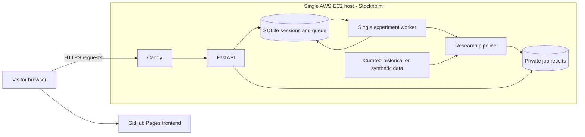

# Power Forecast Lab

I’m using this project to explore electricity-price forecasting in the Germany–Luxembourg (DE-LU) market and how those forecasts affect battery charging and discharging decisions. It brings together data collection, machine learning, optimisation and deployment.

**Question:** How accurately and with what uncertainty can DE-LU day-ahead prices be forecast from information available before the auction, and how does forecast quality affect constrained battery value?

**Success test:** I’ll consider the forecasting study successful when LightGBM beats LEAR on mean pinball loss and meets the declared interval-calibration target on an untouched evaluation period with verified inputs. I’ll also compare point forecasts against yesterday’s prices and battery value under the same costs and constraints.

**Current status:** The app is running on AWS, but the historical results are still exploratory. I haven’t verified the original publication times of all forecast inputs, and I’ve already inspected the development period. I also wrote the question and success test into this README after starting work with the data, so I’m not treating the completed experiment as preregistered research.

## Public demo

[Open the AWS-hosted dashboard](https://power-forecast-lab-api.duckdns.org/) · [Backend health](https://power-forecast-lab-api.duckdns.org/health) · [Source repository](https://github.com/Probeginnercodes/power-price)

I’ve checked the public HTTPS health endpoint and run experiments and CSV downloads locally through Docker. My next deployment check is the complete experiment flow through GitHub Pages. The frontend address is [probeginnercodes.github.io/power-price](https://probeginnercodes.github.io/power-price/); publication and cross-origin testing are still pending in this README.

To try it, open the saved historical example or select one evaluation day and click **Run experiment**. The dashboard shows forecasts, uncertainty intervals, model scores, battery schedules and cost sensitivities. You can also download the results. Synthetic runs are labelled separately; they are there to test the software, not demonstrate market performance.

I’ve kept the public demo small: one worker, 1–3 evaluation days per run, 90/364-day training windows, submission limits and a 180-second timeout. Jobs are separated by anonymous browser sessions. Results expire after 24 hours, so download anything you want to keep. The server needs to be running for experiments to work. Visitors don’t need an ENTSO-E token, and the app doesn’t place trades.

## Architecture



I separated the interface from the model runs so the browser doesn’t have to wait on one long training request. FastAPI validates a request and puts it in a SQLite queue. A separate worker runs the analysis and saves the results. Both use a persistent Docker volume. Each anonymous session can access its own jobs, while the selected historical example is shared. Everything runs on one EC2 instance, so an instance failure interrupts experiments; the volume isn’t an independent backup.

## Run it locally

### With Docker

You’ll need Git and Docker Engine/Desktop with Compose and Linux containers. The synthetic demo works without an API key or historical dataset.

```bash
git clone https://github.com/Probeginnercodes/power-price.git
cd power-price
docker compose up --build
```

Open **http://127.0.0.1:8000/**, select **Synthetic demonstration**, choose **1 evaluation day**, and click **Run experiment**. Inspect the resulting metrics and download a CSV. Stop with Ctrl+C; use `docker compose down` to remove containers while retaining the named volume. Do not use `down -v` unless deliberately deleting hosted state.

I keep `.env`, private keys, raw downloads, generated results and `deployment/seed/` out of Git. A fresh clone can run the synthetic demo. To reproduce the historical study, you’ll also need the archived inputs or a separately prepared seed dataset. Downloading the same dates again may return revised values, so it may not give exactly the same scores. Details are in [data preparation](DATA_PIPELINE.md), [model specification](MODEL_SPEC.md) and [deployment instructions](DEPLOYMENT.md).

### With Python

With Python 3.11 installed, the following Windows PowerShell commands avoid activation-policy changes:

```powershell
py -3.11 -m venv .venv
.\.venv\Scripts\python.exe -m pip install -r requirements-dev.txt
.\.venv\Scripts\python.exe check_quality.py
.\.venv\Scripts\python.exe run_pipeline.py --mode demo --evaluation-days 1
.\.venv\Scripts\python.exe serve.py
```

Open the address printed by `serve.py` for the local research interface. With Node.js on PATH, `python check_quality.py --with-js` also checks the frontend. The latest local check passed 99 Python tests and 22 JavaScript checks. I’ve added a GitHub Actions quality workflow too; its status is shown in the repository’s Actions tab. Passing these checks tells me the software behaves as expected, not that the forecasts are accurate.

## How a forecast becomes a battery decision

| Stage | What happens | Code / retained evidence |
|---|---|---|
| 1. Obtain source data | Request DE-LU auction prices and day-ahead load, wind and solar forecasts. Preserve raw XML and token-redacted metadata. | [download_data.py](download_data.py): receipt times, document metadata and content hashes |
| 2. Prepare hours | Validate source units/resolution and UTC timestamps. Average complete equal-duration intervals; never silently fill missing observations. | [prepare_data.py](prepare_data.py), [prepare_history.py](prepare_history.py): hourly CSV, validation and explicit exclusions |
| 3. Build inputs | Select earlier local-day price profiles at lags 1, 2 and 7, same-hour lag 3, target-hour forecasts and calendar indicators. Exclude incomplete/DST target and source days. | [models.design_table](models.py); [information-set audit](information_set.py); [educational lineage builder](features.py) |
| 4. Transform and fit | Fit location/scale and asinh on training only. Refit 24 LEAR-style hourly LASSOs and LightGBM quantile fits at 10/50/90%, using the declared chronological calibration segment. | [transforms.py](transforms.py), [models.py](models.py): transforms, scalers, coefficients, candidate scores and boosters |
| 5. Predict and score | Invert predictions to EUR/MWh. Retain raw/sorted quantiles and compare outcomes using MAE, RMSE, pinball loss, coverage and matched daily DM diagnostics. | [evaluation.py](evaluation.py): forecasts, metrics, calibration and daily diagnostics |
| 6. Schedule and settle | Optimise a battery schedule using forecasts; freeze those decisions and settle at actual prices. Recompute perfect foresight under the same constraints/costs. | [battery.py](battery.py), [sensitivity.py](sensitivity.py): interval dispatch, net value and scenario tables |

The fitted price transform is `z = asinh((price - location) / scale)`; inversion is `price_hat = location + scale * sinh(z_hat)`. Its inverted point prediction is not automatically a conditional mean. Monotone quantile rearrangement uses no test outcomes.

For example, suppose the battery buys 1 MWh at EUR 50/MWh and sells 0.9 MWh at EUR 120/MWh after 90% round-trip efficiency. The gross margin is `0.9 * 120 - 1 * 50 = EUR 58`. At EUR 2/MWh charged plus discharged, with no extra import fee, that becomes `58 - 2 * (1 + 0.9) = EUR 54.20`. This is just an arithmetic example, not one of my measured results. The actual optimiser also handles power and capacity limits, prevents simultaneous charging/discharging and starts and ends each day empty.

## Results so far

The table below comes from my seven-day development run for **15–21 October 2026**: 168 forecast hours with a rolling **364-calendar-day** training window. Missing/DST exclusions reduce the usable training observations. The saved experiment ID is `20261024T170430888686Z_empirical_b972e4`. I’ve already inspected these dates, so they are development data rather than a final untouched test.

| Model | MAE EUR/MWh | RMSE EUR/MWh | Mean pinball EUR/MWh | 80% coverage | Battery net EUR | Upper-bound capture |
|---|---:|---:|---:|---:|---:|---:|
| LEAR-style | 39.97 | 46.42 | 8.72 | 67.3% | 2,210.49 | 88.3% |
| LightGBM | 30.48 | 37.08 | 11.74 | 44.0% | 2,065.83 | 82.6% |
| Yesterday naive | **27.30** | **34.25** | — | — | 1,976.55 | 79.0% |
| Perfect foresight | — | — | — | — | 2,502.18 | 100.0% |

**My models did not beat yesterday’s-price baseline on point accuracy over this week.** LightGBM had lower MAE than LEAR but worse pinball loss, and both models missed their 80% coverage target. Their battery schedules still captured more value than the naive policy. That is the main finding I want to investigate: lower price error and better battery decisions are not necessarily the same thing. I’m keeping the full-week result here rather than replacing it with a better-looking one-day run.

The daily absolute-loss DM statistic was about 2.75 with raw p=0.033, but that uses only seven daily losses. I don’t treat it as convincing evidence of a stable advantage. It also tests absolute loss, not the main pinball objective. More detail is in the [results note](RESULTS_NOTE.md).

## Leakage checks and data limits

- [x] Request day-ahead forecasts rather than actual wind/solar generation as inputs.
- [x] Preserve UTC identity and Berlin delivery labels; reject duplicate or timezone-naive timestamps.
- [x] Exclude incomplete and 23/25-hour local target/lag-source days explicitly.
- [x] Keep target prices out of features and train on earlier delivery days.
- [x] Select alpha on chronological inner calibration data; fit each scaler/asinh within its training split.
- [x] Test that changing held-out actual prices cannot change fitted forecasts.
- [x] Retain raw quantiles and apply predeclared outcome-independent sorting.
- [x] Freeze forecast-based battery decisions before actual-price settlement; use matching upper-bound constraints.
- [ ] Verify the true auction cutoff and exact original/revised publication evidence for every forecast input and lagged auction-price value.
- [ ] Assign and freeze an untouched final evaluation period before accessing its outcomes.
- [ ] Recover earlier unarchived human trials or keep their count explicitly unknown.

I currently use D-1 11:00 Berlin as an assumed research cutoff; I still need to verify the actual auction deadline. Download and XML creation timestamps alone don’t prove when the original values were published. For that reason, the strict historical command below intentionally stops rather than marking the inputs as verified:

```bash
python run_pipeline.py --mode empirical --acknowledge-unverified-vintages --require-verified-vintages
```

Source history covers 2025-10-08 to 2026-10-22 UTC exclusive. Preparation retained 9,095 complete hourly observations and excluded one incomplete hour at 2025-10-25 22:00 UTC involving solar/onshore-wind quarters. Native 15-minute averaging loses granular trading opportunities. Missing/DST exclusions affect representativeness, external-source cross-checks are incomplete, and crisis-regime performance is not established.

## Next research step: prospective evaluation

**I haven’t implemented a prospective collector or completed a prospective evaluation yet.** The current [protocol](research_protocol.json) records the development work retrospectively; I still need to assign the final holdout dates. My plan for the next study is:

1. Verify the auction deadline and declare a forecast cutoff before auction results become available, not merely before the delivery day starts.
2. Freeze features, models, training windows, quantiles, primary pinball comparison, calibration target, battery assumptions and the statistical testing family in a dated Git commit.
3. Implement and schedule pre-cutoff collection. Preserve exact raw responses, source revisions, hashes and collection/publication evidence; record the training-data snapshot available at each forecast time as well as current feature inputs.
4. Generate and save predictions before the cutoff/outcomes; retain failures and missed days. Never backfill a missed prediction and label it prospective.
5. Obtain clearing-price outcomes after publication, then score the locked forecasts and actual-settled dispatch. Keep these results separate from the historical development sample.
6. Report the predeclared metrics, uncertainty/dependence treatment and every subsequent variant. If outcomes influence tuning, designate that period as development and reserve another untouched evaluation.

The important part is saving what was available and what the model predicted before seeing the answer. Until those records exist, I’m keeping the historical results exploratory. I track the remaining requirements in [research rules](RESEARCH_RULES.md) and the [decision log](RESEARCH_DECISIONS.md).

## Trial accounting

My archive snapshot at **2026-10-24 19:08 UTC** contained 12 executions, zero recorded failures, two model-configuration signatures and five empirical test signatures with DM p-values. Those are different counts, and they are only a snapshot. I can’t reconstruct the complete number of earlier experiments. Code-only changes can split test signatures, while identical repeated tests are deduplicated for adjustment.

I use [research_audit.py](research_audit.py) to inventory saved successes and failures and calculate diagnostic Holm adjustments. New runs update the ledger, and LEAR fits save the calibration scores for every alpha candidate. The adjustment doesn’t fix missing trial history or leakage, so I’m not using it to claim final significance. I’ll record new hypotheses and selection decisions in [RESEARCH_DECISIONS.md](RESEARCH_DECISIONS.md) before running them.

## Battery costs and sensitivity

Baseline: **1 MW / 4 MWh**, **90%** round-trip efficiency, daily empty start/end, **EUR 2/MWh charged plus discharged**, zero extra import fee. Linear physical/objective relationships plus binary mode variables form a MILP extension of the brief's LP, preventing simultaneous charging/discharging at negative prices.

I tested the assumptions one at a time, keeping the price forecasts unchanged and reoptimising every policy, including perfect foresight, under matching settings. The table shows total net EUR over the same seven days. I use it to understand sensitivity, not to select whichever scenario happens to look most profitable.

| Scenario | Perfect foresight | LEAR | LightGBM | Naive |
|---|---:|---:|---:|---:|
| baseline | 2,502.18 | 2,210.49 | 2,065.83 | 1,976.55 |
| capacity_mwh=2 | 1,628.89 | 1,446.22 | 1,310.90 | 1,364.66 |
| capacity_mwh=8 | 2,752.01 | 2,341.84 | 2,129.83 | 1,841.97 |
| import_fee_eur_mwh=10 | 2,002.18 | 1,713.42 | 1,565.99 | 1,406.95 |
| import_fee_eur_mwh=5 | 2,246.88 | 1,959.99 | 1,837.19 | 1,691.58 |
| round_trip_efficiency=0.8 | 1,469.75 | 1,170.51 | 1,012.51 | 849.03 |
| round_trip_efficiency=0.95 | 3,047.24 | 2,740.72 | 2,788.17 | 2,586.39 |
| throughput_cost_eur_mwh=0 | 2,704.13 | 2,414.34 | 2,355.19 | 2,236.43 |
| throughput_cost_eur_mwh=10 | 1,763.57 | 1,493.36 | 1,319.85 | 1,157.32 |
| throughput_cost_eur_mwh=5 | 2,212.20 | 1,934.77 | 1,809.14 | 1,655.52 |

These are simplified energy-arbitrage operating values, not all-in profit. Market impact, capital/financing and unconfigured grid/tax/capacity charges are omitted. Throughput cost is a wear proxy, not calibrated degradation. EUR/MWh costs are used rather than mechanically applying equity-style basis points to possibly negative electricity prices.

## What I’m working on next

I’m using this project to practise the full development cycle: collecting data, checking assumptions, building models, testing them and deploying an application that other people can use.

My learning plan is to rebuild the pieces in order: ingestion and schemas; timestamp checks; transforms and features; models and evaluation; battery optimisation; then the API, queue, frontend, tests and deployment. For each piece, I want to explain the inputs and outputs, write a small example and debug changes independently.

[Engineering guide](ENGINEERING_GUIDE.md) · [Scope/requirements](REQUIREMENTS_TRACEABILITY.md) · [Deployment guide](DEPLOYMENT.md) · [Model/data assumptions](MODEL_SPEC.md)

I’ve kept neural networks, nine-quantile ensembles, conformal wrappers, price simulation and multi-day storage outside the current scope. First I want to verify input timing and evaluate the existing models properly. The Pages workflow is in `.github/workflows/pages.yml`; it takes `https://power-forecast-lab-api.duckdns.org` as the backend origin.
