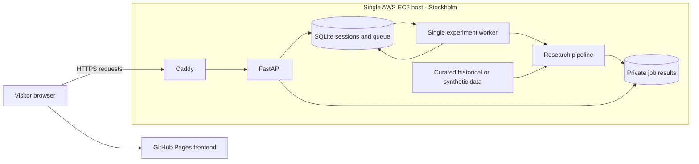

# Power Forecast Lab

DE-LU day-ahead electricity-price forecasting and constrained battery valuation: a reduced Project 5 research application with a public portfolio demo.

**Question:** How accurately and with what uncertainty can DE-LU day-ahead prices be forecast from information available before the auction, and how does forecast quality affect constrained battery value?

**Success test:** On a predeclared untouched evaluation period with verified input vintages, LightGBM must beat LEAR on mean pinball loss, meet the declared interval-calibration target, and report point accuracy against naive plus battery value under matched costs and constraints.

**Research status:** Exploratory. Original historical forecast vintages are unverified, the inspected development period is not an untouched holdout, and the predictive success test has not been met. The question and success test were consolidated into this README after data inspection began; they were not recorded here on day one.

## Public demo

[Open the AWS-hosted dashboard](https://power-forecast-lab-api.duckdns.org/) · [Backend health](https://power-forecast-lab-api.duckdns.org/health) · [Source repository](https://github.com/Probeginnercodes/power-price)

The owner has verified the public HTTPS health endpoint and local Docker experiment/download flow. A complete public-browser experiment and the GitHub Pages cross-origin flow still require final verification; no uptime guarantee is claimed. The intended frontend URL is [probeginnercodes.github.io/power-price](https://probeginnercodes.github.io/power-price/), pending Pages publication.

To explore the demo: inspect the saved historical example, or choose one evaluation day and run an experiment. Historical runs require acknowledgement of the vintage limitation. Inspect forecast intervals, model metrics, dispatch, cost sensitivities and CSV downloads. Synthetic demonstration results are visibly labelled and are not market evidence.

The public demo uses anonymous session-isolated jobs, one worker, 1–3 evaluation days, supported 90/364-day training windows, submission quotas and a 180-second timeout. Private results expire after 24 hours: download them before then. Availability depends on the EC2 instance and remaining demo capacity. No ENTSO-E token is accepted from visitors and no trades are placed.

## Architecture



The browser loads the frontend from Pages and calls the separate HTTPS backend. FastAPI validates and queues requests; the worker performs training outside HTTP handlers. SQLite and output directories use persistent Docker volumes. Job results are scoped to anonymous bearer sessions, with only the deliberately selected historical example shared publicly. This is a single-host portfolio design: volumes are not independent backups, and server failure interrupts live experiments.

## Reproduce from a fresh clone

### Docker: synthetic experiment, no API key or private dataset required

Prerequisites: Git and Docker Engine/Desktop with Compose and Linux-container support.

```bash
git clone https://github.com/Probeginnercodes/power-price.git
cd power-price
docker compose up --build
```

Open **http://127.0.0.1:8000/**, select **Synthetic demonstration**, choose **1 evaluation day**, and click **Run experiment**. Inspect the resulting metrics and download a CSV. Stop with Ctrl+C; use `docker compose down` to remove containers while retaining the named volume. Do not use `down -v` unless deliberately deleting hosted state.

The repository excludes `.env`, private keys, raw downloads, generated results and `deployment/seed/`. Consequently, a fresh clone provides the synthetic path; reproducing historical results additionally requires the original archived inputs or a separately prepared curated seed. Fresh API downloads can contain revisions and are not guaranteed to reproduce the published historical table exactly. See [data preparation](DATA_PIPELINE.md), [model specification](MODEL_SPEC.md) and [deployment/seed instructions](DEPLOYMENT.md).

### Native Python checks and local research interface

With Python 3.11 installed, the following Windows PowerShell commands avoid activation-policy changes:

```powershell
py -3.11 -m venv .venv
.\.venv\Scripts\python.exe -m pip install -r requirements-dev.txt
.\.venv\Scripts\python.exe check_quality.py
.\.venv\Scripts\python.exe run_pipeline.py --mode demo --evaluation-days 1
.\.venv\Scripts\python.exe serve.py
```

Open the address printed by `serve.py`. This local research interface is separate from the hosted API/worker interface. With Node.js on PATH, `python check_quality.py --with-js` adds frontend checks. GitHub Actions is configured to run quality checks; a workflow file alone is not evidence that remote CI has passed. The latest local verification recorded 99 Python tests and 22 JavaScript checks passing; these establish software behaviour, not forecasting validity.

## One complete path: API response to battery revenue

| Stage | What happens | Code / retained evidence |
|---|---|---|
| 1. Obtain source data | Request DE-LU auction prices and day-ahead load, wind and solar forecasts. Preserve raw XML and token-redacted metadata. | [download_data.py](download_data.py): receipt times, document metadata and content hashes |
| 2. Prepare hours | Validate source units/resolution and UTC timestamps. Average complete equal-duration intervals; never silently fill missing observations. | [prepare_data.py](prepare_data.py), [prepare_history.py](prepare_history.py): hourly CSV, validation and explicit exclusions |
| 3. Build inputs | Select earlier local-day price profiles at lags 1, 2 and 7, same-hour lag 3, target-hour forecasts and calendar indicators. Exclude incomplete/DST target and source days. | [models.design_table](models.py); [information-set audit](information_set.py); [educational lineage builder](features.py) |
| 4. Transform and fit | Fit location/scale and asinh on training only. Refit 24 LEAR-style hourly LASSOs and LightGBM quantile fits at 10/50/90%, using the declared chronological calibration segment. | [transforms.py](transforms.py), [models.py](models.py): transforms, scalers, coefficients, candidate scores and boosters |
| 5. Predict and score | Invert predictions to EUR/MWh. Retain raw/sorted quantiles and compare outcomes using MAE, RMSE, pinball loss, coverage and matched daily DM diagnostics. | [evaluation.py](evaluation.py): forecasts, metrics, calibration and daily diagnostics |
| 6. Schedule and settle | Optimise a battery schedule using forecasts; freeze those decisions and settle at actual prices. Recompute perfect foresight under the same constraints/costs. | [battery.py](battery.py), [sensitivity.py](sensitivity.py): interval dispatch, net value and scenario tables |

The fitted price transform is `z = asinh((price - location) / scale)`; inversion is `price_hat = location + scale * sinh(z_hat)`. Its inverted point prediction is not automatically a conditional mean. Monotone quantile rearrangement uses no test outcomes.

A settlement illustration, **not a measured project result**: charge 1 MWh at EUR 50/MWh, then sell 0.9 MWh at EUR 120/MWh after 90% round-trip efficiency. Gross margin is `0.9 * 120 - 1 * 50 = EUR 58`. With EUR 2/MWh charged plus discharged and zero import fee, net operating value is `58 - 2 * (1 + 0.9) = EUR 54.20`. The optimiser also enforces power/capacity limits, exclusive charging/discharging and empty daily start/end states; this arithmetic alone is not the optimisation algorithm.

## Historical results: negative findings included

Development experiment `20261024T170430888686Z_empirical_b972e4`: **15–21 October 2026**, 168 forecast hours, trailing **364-calendar-day** training windows with explicit exclusions. These dates have already been inspected.

| Model | MAE EUR/MWh | RMSE EUR/MWh | Mean pinball EUR/MWh | 80% coverage | Battery net EUR | Upper-bound capture |
|---|---:|---:|---:|---:|---:|---:|
| LEAR-style | 39.97 | 46.42 | 8.72 | 67.3% | 2,210.49 | 88.3% |
| LightGBM | 30.48 | 37.08 | 11.74 | 44.0% | 2,065.83 | 82.6% |
| Yesterday naive | **27.30** | **34.25** | — | — | 1,976.55 | 79.0% |
| Perfect foresight | — | — | — | — | 2,502.18 | 100.0% |

**Neither model beat naive on point accuracy over this week.** LightGBM beat LEAR on MAE but lost on pinball loss; both intervals undercovered. Better battery value than naive is a distinct finding, not a reversal of the accuracy result. A favourable one-day demonstration does not replace this seven-day table.

The daily absolute-loss DM diagnostic was approximately 2.75 with raw p=0.033, based on only seven daily losses. It does not establish persuasive significance and does not test the primary pinball objective. No final significance claim is made. See [results note](RESULTS_NOTE.md).

## Leakage checklist and limits

- [x] Request day-ahead forecasts rather than actual wind/solar generation as inputs.
- [x] Preserve UTC identity and Berlin delivery labels; reject duplicate or timezone-naive timestamps.
- [x] Exclude incomplete and 23/25-hour local target/lag-source days explicitly.
- [x] Keep target prices out of features and train on earlier delivery days.
- [x] Select alpha on chronological inner calibration data; fit each scaler/asinh within its training split.
- [x] Test that changing held-out actual prices cannot change fitted forecasts.
- [x] Retain raw quantiles and apply predeclared outcome-independent sorting.
- [x] Freeze forecast-based battery decisions before actual-price settlement; use matching upper-bound constraints.
- [ ] Verify the true auction cutoff and exact original/revised publication evidence for every forecast input and lagged auction-price value.
- [ ] Assign and freeze an untouched final evaluation period before accessing its outcomes.
- [ ] Recover earlier unarchived human trials or keep their count explicitly unknown.

The D-1 11:00 Berlin cutoff in the current audit is a research assumption, not a verified auction deadline. Receipt time and XML creation time do not automatically prove original publication. The strict command below intentionally fails closed for current historical data:

```bash
python run_pipeline.py --mode empirical --acknowledge-unverified-vintages --require-verified-vintages
```

Source history covers 2025-10-08 to 2026-10-22 UTC exclusive. Preparation retained 9,095 complete hourly observations and excluded one incomplete hour at 2025-10-25 22:00 UTC involving solar/onshore-wind quarters. Native 15-minute averaging loses granular trading opportunities. Missing/DST exclusions affect representativeness, external-source cross-checks are incomplete, and crisis-regime performance is not established.

## Prospective evaluation: planned, not completed

**No prospective collector or prospective holdout result is claimed here.** The existing [protocol](research_protocol.json) documents retrospective development; final holdout dates remain unassigned. The next study must be frozen before its outcomes are inspected:

1. Verify the auction deadline and declare a forecast cutoff before auction results become available, not merely before the delivery day starts.
2. Freeze features, models, training windows, quantiles, primary pinball comparison, calibration target, battery assumptions and the statistical testing family in a dated Git commit.
3. Implement and schedule pre-cutoff collection. Preserve exact raw responses, source revisions, hashes and collection/publication evidence; record the training-data snapshot available at each forecast time as well as current feature inputs.
4. Generate and save predictions before the cutoff/outcomes; retain failures and missed days. Never backfill a missed prediction and label it prospective.
5. Obtain clearing-price outcomes after publication, then score the locked forecasts and actual-settled dispatch. Keep these results separate from the historical development sample.
6. Report the predeclared metrics, uncertainty/dependence treatment and every subsequent variant. If outcomes influence tuning, designate that period as development and reserve another untouched evaluation.

This process addresses the information-timing gap only when the collection, timing evidence and immutable prediction records actually exist. A longer sample or a written plan alone does not establish leakage-free inference. See [research rules](RESEARCH_RULES.md) and [decision log](RESEARCH_DECISIONS.md).

## Trial accounting

The archive inventory at **2026-10-24 19:08 UTC** contained 12 executions, zero recorded failures, two model-configuration signatures and five empirical test signatures with DM p-values. It is a dated snapshot, not the current lifetime total. **The lifetime number of human trials is unknown.** Code-only changes can conservatively split test signatures; identical repeated tests are deduplicated for adjustment.

[research_audit.py](research_audit.py) inventories available successes/failures and exports diagnostic Holm adjustments. New pipeline runs refresh their ledger and new LEAR fits retain all alpha calibration candidates. These adjustments do not repair missing trial history, leakage, inspected dates or short samples; research inference remains disabled. Human hypotheses and selection decisions belong in [RESEARCH_DECISIONS.md](RESEARCH_DECISIONS.md) before each experiment.

## Battery costs and sensitivity

Baseline: **1 MW / 4 MWh**, **90%** round-trip efficiency, daily empty start/end, **EUR 2/MWh charged plus discharged**, zero extra import fee. Linear physical/objective relationships plus binary mode variables form a MILP extension of the brief's LP, preventing simultaneous charging/discharging at negative prices.

Period-total net EUR below changes one assumption at a time, reoptimising every policy using unchanged forecasts and recomputing perfect foresight under matching settings. These scenarios are descriptive, not a strategy-selection search.

| Scenario | Perfect foresight | LEAR | LightGBM | Naive |
|---|---:|---:|---:|---:|
| baseline | 2,502.18 | 2,210.49 | 2,065.83 | 1,976.55 |
| capacity_mwh=2 | 1,628.89 | 1,446.22 | 1,310.90 | 1,364.66 |
| capacity_mwh=8 | 2,752.01 | 2,341.84 | 2,129.83 | 1,841.97 |
| import_fee_eur_mwh=10 | 2,002.18 | 1,713.42 | 1,565.99 | 1,406.95 |
| import_fee_eur_mwh=5 | 2,246.88 | 1,959.99 | 1,837.19 | 1,691.58 |
| round_trip_efficiency=0.8 | 1,469.75 | 1,170.51 | 1,012.51 | 849.03 |
| round_trip_efficiency=0.95 | 3,047.24 | 2,740.72 | 2,788.17 | 2,586.39 |
| throughput_cost_eur_mwh=0 | 2,704.13 | 2,414.34 | 2,355.19 | 2,236.43 |
| throughput_cost_eur_mwh=10 | 1,763.57 | 1,493.36 | 1,319.85 | 1,157.32 |
| throughput_cost_eur_mwh=5 | 2,212.20 | 1,934.77 | 1,809.14 | 1,655.52 |

These are simplified energy-arbitrage operating values, not all-in profit. Market impact, capital/financing and unconfigured grid/tax/capacity charges are omitted. Throughput cost is a wear proxy, not calibrated degradation. EUR/MWh costs are used rather than mechanically applying equity-style basis points to possibly negative electricity prices.

## Development and learning map

Development used AI assistance. The walkthrough and learning map support an independent rebuild, with emphasis on explaining assumptions, writing tests and debugging changes.

For an independent rebuild: implement ingestion and schemas first; add timestamp/availability checks; build train-only transforms/features; fit and evaluate benchmarks; add optimisation; then build the API, queue, frontend, tests, containers and monitored deployment. At each stage, explain its contract and failure modes, reproduce a small example, and modify it without copying the existing implementation.

[Engineering guide](ENGINEERING_GUIDE.md) · [Scope/requirements](REQUIREMENTS_TRACEABILITY.md) · [Deployment guide](DEPLOYMENT.md) · [Model/data assumptions](MODEL_SPEC.md)

The reduced scope excludes neural nets, nine-quantile ensembles/conformal wrappers, price simulation and multi-day storage. GitHub Pages publication is prepared in `.github/workflows/pages.yml`; enable Actions as the Pages source and run **Publish portfolio frontend** with `https://power-forecast-lab-api.duckdns.org`. Publishing the UI does not establish research validity.
